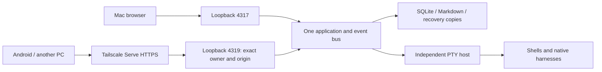

# Private remote workspace

Agentic OS remains one Bun/Hono server with SQLite and an independent PTY host.
The Mac runs the agents and retains the repositories. Another PC or Android device
uses the same workspace in its browser. Interactive agent permissions are unchanged.



## Runtime and upgrade

The server acquires an OS lock and binds its listener ports before opening the DB
or running recovery. The PTY host holds a separate OS lock. Killing the app server
does not stop its terminals. Startup failure disposes already-started resources.
The development command supervises both its children and uses `data/dev`, API port
4320 and Vite port 5173. Production keeps `data` and port 4317. Development ignores
remote ingress configuration. `AGENTIC_OS_DATA` can select an explicit data directory;
never point a development process at daily-use data.

Pending migrations take a checked SQLite snapshot automatically.

## Restarting from any device

The system panel's **Reiniciar…** offers two restarts, both through
`POST /api/system/restart` (`{"scope": "server" | "all"}`), allowed on remote ingress:

- **Reiniciar el servidor** loads new server code. Terminals keep running in the PTY host.
- **Reiniciar todo** first rebuilds the page into `dist/` (`scripts/refresh.ts`, about 3 s; a
  failed build keeps the old page and the restart goes on), so nothing of the old code is left
  running once the page reloads. Then it also stops the PTY host. The server asks it over its loopback API
  (`POST /shutdown?force=1` with the host's token; Windows has no SIGTERM): the host stops its
  terminals and leaves them `running` in the database, and the next host marks them lost and
  resumes every agent session (Claude, Codex, Grok). Shells and env commands close. This is how
  a host running old code (the panel's warning) is replaced. A host from before `force`
  refuses while busy: on macOS the server falls back to SIGTERM; on Windows that host is kept
  until its terminals end, and then the next start replaces it.

Before anything stops, the server refuses with 409 and the reason when it does not run
under `scripts/supervise.ts` (nobody would start it again), when `data/config.json` no
longer validates, when `server/index.ts` or `server/host/main.ts` would not compile, or
while another restart runs. Otherwise it answers 202 with its pid, stops serving, stops
the host (scope `all`, waiting up to 10 s; a host that stays is kept as stale) and exits
0. The supervisor starts it at once and it starts a fresh host. The page waits for a
server with another pid on `/api/health` and reloads.

The launcher uses the same route without asking, so it also works from a terminal inside
the app (that window closes with the host). Only a server without the supervisor, or one
from before the route, falls back to stopping the supervisor, server and host by hand.
The supervisor itself keeps its code until it starts again: at login, or from the
launcher while the server is down.

## Prepare private access

1. Install Tailscale on the Mac and both client devices. Sign in with the intended
   owner account. Ensure HTTPS is enabled for the tailnet. Do not enable Funnel.
2. Run `bun scripts/remote-setup.ts diagnose`. Then run
   `bun scripts/remote-setup.ts prepare /absolute/new/review-directory`.
   Preparation reads the machine's real identity and emits `config.proposed.json`
   and activation instructions. It changes no running service.
   It refuses an existing Serve configuration rather than replacing its routes.
3. Review the proposed config. Only the exact `remote.login` may enter; host and
   origin must match `remote.origin`. Install that config after the offline backup.
   Then use **Reiniciar el servidor**: the remote listener opens with the new config.
4. Keep the server running with the one launcher, `scripts/start-agentic-os.command`,
   linked as `~/Applications/start-agentic-os.command` and listed in Login Items. It runs
   from Terminal.app because macOS blocks background agents (launchd) from reading
   `~/Desktop`, where the repo lives. It starts `scripts/supervise.ts`, which restarts the
   server at once after a clean exit and after a crash with a wait that grows to a minute,
   never giving up (nobody may be at the Mac). It stops only on its own SIGTERM or when
   another server owns the data (exit 3). Like any
   login item, it starts only after the user logs in, never before FileVault unlock.
5. Run the generated private Serve command, which forwards HTTPS to
   `http://127.0.0.1:4319`. Open the generated `https://<machine>.<tailnet>.ts.net`
   URL from the PC and Android browser while connected to Tailscale.
6. On every start and restart, the launcher then runs `bun scripts/remote-setup.ts ensure`:
   with `remote.enabled`, it opens the Tailscale app in the background, connects it when it
   is stopped (a reboot leaves it so) and restores this app's own Serve route when Serve is
   empty. It never replaces other routes and refuses a route to the local port. A login
   Tailscale needs, or a tunnel not up within 60 s, keeps the launcher window open with the
   reason; the local app runs anyway.

Serve supplies the authenticated `Tailscale-User-Login` header. The remote listener
is bound to loopback, checks identity for HTML, assets, APIs, SSE and WebSockets,
and requires an exact Origin on writes and upgrades. It rejects Funnel traffic.
Local processes retain the existing same-user trust; this is not isolation from
malicious software already running on the Mac. Restrict tailnet access to intended
devices as well. Tagged nodes without an owner identity are refused.

See the official [Serve identity-header guidance](https://tailscale.com/docs/features/tailscale-serve)
and [Serve CLI reference](https://tailscale.com/docs/reference/tailscale-cli/serve).

To disable remote access, turn off `remote.enabled` and restart the app. Remove
only the Serve route created for this app (`tailscale serve --https=443 off` for
the generated root route); do not reset other applications' Serve configuration.

## Availability and device behavior

Remote availability requests `caffeinate -s`: it holds system sleep on AC power
without holding the display awake. The supervisor (`scripts/supervise.ts`) holds it for its
whole life and tells the server with `AOS_SUPERVISOR_AWAKE`, so a server restart leaves no gap in
which a Mac with its lid closed falls asleep; a server started without a supervisor holds its
own. A change to `remote.enabled` takes a supervisor restart. macOS lock and display sleep remain available.
A closed lid, battery power, reboot/FileVault and OS management policies can prevent
remote availability. Verify the actual hardware conditions below.

Mesa names, membership and work blocks are shared in SQLite (`workspace_state.body` is
`{mesas, blocks}`; a bare Mesas array from before blocks still reads, with none). A browser
sends each change as one intent (add, remove, move, create, close, rename, assign,
block-create, block-update, block-remove, block-move) with a request UUID, and the
server applies it to its current Mesas: two devices never refuse each other for a
stale revision, and no command sets a Mesa's members wholesale. Only a real clash
is refused: a terminal already in another Mesa, a full Mesa, or a block another device
removed. A removed block's Mesas stay, without a block. A failed response
is retried with the same UUID: a command without an answer stays in this tab's
memory until it is retried or discarded for the server's Mesas, and a reload drops
it. A refusal applies the server's state and says why. Layouts remain local; the active mesa is held per tab.
The first local browser imports its old mesas only into an empty server. The old
workspace is retained as `aos.mesas.before-sync`. A remote browser cannot initialize
an empty workspace over the local user's saved mesas.

Below 768px, the workspace displays one panel with mesa/panel selectors and touch
keys. Agent messages use a native textarea, preserve drafts and reuse a request UUID
on retry. Registration is not proof of delivery: inspect Messages for delivered,
answered, failed or uncertain status. Keyboard input is disabled until an attached
snapshot arrives and is never queued for reconnection. Reconnects do not take control
from another device; use **Traer aquí** explicitly.

Copy and paste use the client device's clipboard. In a shell, Codex or Grok, drag to
select and press Ctrl+C (with nothing selected it stays ^C); the window writes the
selection to the clipboard itself. Ctrl+V pastes. When a program holds the mouse,
Shift+drag still selects in xterm. Claude in fullscreen owns its selection and copies it on
mouse release (or Ctrl+C with `copyOnSelect` off): locally it runs `pbcopy` (the Mac's
clipboard) and also sends OSC 52, which the terminal window writes to its device's clipboard
(`web/features/terminals/terminal-socket.ts`). OSC 52 reads are never answered, and a
reconnect's snapshot never copies again.

Upload or paste images from the client device. **Capturar** on a remote device shoots
that device's own screen through the browser's screen picker (none on Android). The
folder picker and **Añadir repo** list the Mac's folders remotely. The Mac's own screen
capture, opening a folder on the Mac, OAuth setup and the Workboard hook stay
local-desktop operations and are refused on remote ingress.

On the Mac, captures go through `AgenticCapture.app` (`bun run mac:build AgenticCapture`),
which holds the Screen Recording permission, so Terminal and the agents' shells never need
it. The production hub keeps it running for ⌃⌘4 in any app (`images.captureHotkey`, on by
default): the selection is kept as "captured" in the image history and its path is typed,
without Enter, into the terminal focused last in any browser tab, and the helper shows the result
for 2 s in a floating notice. A tab switched to the PC clears that target, so the capture stays in the history.
Each rebuild of the helper is a new identity for macOS and asks for the permission again. Each API route declares its reach
in `server/remote-routes.ts`; a route missing there is refused remotely and fails
`remote-routes.test.ts`. Mesa layouts are kept per browser origin: a new URL starts
with empty layouts. A remote session controls the Mac's agents with their usual
permissions. PR review prompts request non-modifying behavior; only the separate
consultation adapters provide their documented restricted execution policy.

## A second machine (worker)

A Windows PC runs the same server with `role: "worker"` and its own data folder; the hub lists
it in `machines` and reaches it through its Tailscale Serve name (`server/machines.ts`). Each
browser tab picks the machine it works on (the Mac | PC switch); see ADR 0013 for its keys.

- **Run it under the supervisor**, so a restart or an update brings it back:
  `$env:AGENTIC_OS_DATA="C:\agentic-os\data"; bun C:\agentic-os\app\scripts\supervise.ts`.
  To start it at logon, register a scheduled task once (pwsh):

  ```powershell
  [Environment]::SetEnvironmentVariable("AGENTIC_OS_DATA", "C:\agentic-os\data", "User")
  $bun = (Get-Command bun).Source
  $act = New-ScheduledTaskAction -Execute $bun -Argument "C:\agentic-os\app\scripts\supervise.ts" -WorkingDirectory "C:\agentic-os\app"
  Register-ScheduledTask -TaskName "Agentic OS worker" -Action $act -Trigger (New-ScheduledTaskTrigger -AtLogOn -User $env:USERNAME)
  ```

  Or use its shortcuts: `scripts\worker.ps1 install -Hub <the Mac's Tailscale name>` (once,
  after `powershell -ExecutionPolicy Bypass -File`) puts «Agentic OS», «Parar Agentic OS» and
  «Enviar logs de Agentic OS» on the desktop and in the Start menu, with `bin\agentic-os.ico`.
  «Agentic OS» starts the supervisor with no window, restores the Tailscale Serve route
  (`scripts/remote-setup.ts ensure`) and opens the browser; a server or supervisor left without
  the other is stopped first. «Parar» ends both; the PTY host and its terminals stay. One click
  at a time (a mutex), and health is read on `127.0.0.1`: Windows tries `::1` first for
  `localhost`, where the server does not listen. `install` also puts `start -NoBrowser` in the
  Startup folder, so the worker and its Serve route come back at logon with no admin rights
  (`ensure` waits up to 60 s for Tailscale). Tailscale runs unattended on the PC
  (`tailscale set --unattended`, done 2026-10-11), so it joins the tailnet before anyone logs in.
- **The Serve route keeps itself**: every server with `remote.enabled` checks its own route once
  a minute (`keepRoute` in `server/tailscale.ts`: one `tailscale serve status --json` while the
  route is there) and puts it back with `serve --bg` when it is lost and Tailscale runs. It never
  runs `tailscale up` (a disconnect someone chose stays chosen) and never takes a 443 another app
  holds; other apps on other ports are left alone. Changes land in `server.log` as `tailscale:`
  lines. A route made by hand without `--bg` lives only while its command runs, and is gone
  after a reboot.
- **Why a worker is offline**: the switch shows the reason beside it while the tab works on that
  machine. A 502 from Serve means the worker's server is down. No answer is told apart by the
  hub's own `tailscale status`: the machine is off the tailnet (with when it was last seen), or
  it is on and publishes no route (back on its own within a minute).
- **Terminal windows** retry for 5 minutes on a dropped socket (a worker reboot, a Tailscale
  restart); the hub gives up on a worker socket that has not opened in 10 s, so the window's
  backoff drives the retry.
- **Logs**: `data\launcher.log` (each launcher step), `data\server.log` and `data\pty-host.log`.
  With the worker up, the hub reads them at `/api/machines/<id>/system/logs?lines=200` (plain
  text; `GET /api/system/logs` on any machine). With it down, a failed start or «Enviar logs»
  sends them to the Mac by Taildrop (`~/Downloads/agentic-os-pc-*.log`). The server finds its
  supervisor by `AOS_SUPERVISOR_PID`, which the supervisor sets: Windows has no reliable parent
  pid.
- **Pair it once**: `bun scripts/pair.ts` on the PC (with `AGENTIC_OS_DATA` set; it refuses
  without it) prints a token and keeps only its hash in `data/pairing.json`. Paste the token in «Actualizar PC», from either browser; the hub keeps it in the
  Keychain (`machines.tokens`).
- **Update it from the hub**: the switch shows «Actualizar PC» while the worker runs other code
  than the Mac. The hub packs `server/`, `shared/`, `scripts/`, `migrations/`, `dist/`, `bin/` and
  the package files (no tests) and posts them to the worker's `POST /api/system/update` with the
  token. The worker unpacks them under `data/update/`, checks the new code would start, copies
  over the app and restarts its server. Every refusal comes before the copy and leaves the
  app as it was; so does a second update while one is applied, or while the last one is on
  trial. The token guards only this route; the rest of the worker trusts the Tailscale
  identity, as the phone does.
- **New packages**: a changed `package.json` or `bun.lock` writes `data/install-pending` and
  makes the update restart everything. The supervisor runs `bun install --frozen-lockfile`
  before the next start once no PTY host is alive (on Windows the host holds the native PTY
  module open). A failed install keeps the mark, logs why and starts the old packages.
- **Rollback**: before the copy the bundled paths and `app-version` are copied (not renamed:
  Windows will not rename an open folder) to `data/app.prev`, and `data/update-trial.json` is
  written. Three error exits (not a clean stop, not a busy lock) within 2 minutes of the new
  server's first start replace those paths with `app.prev`, so files the update added go too,
  and restore `app-version` (the hub then shows the worker behind) and the old packages. A clean
  stop, or a trial that runs out, keeps the update. Files the hub deleted stay on the worker:
  nothing loads code by listing a folder except `migrations/`, whose files are never deleted.
  The supervisor reads these files, so a supervisor started before this code needs one
  `worker.ps1 start` to load it.
- **Restart**: «Reiniciar el servidor» and «Reiniciar todo» both work on a worker tab.
- **Pairing file**: on Windows `scripts/pair.ts` limits `pairing.json` to the current user with
  `icacls` (the mode bits do nothing there).
- **`aos` on another machine**: `aos list --machine win` (or `AOS_MACHINE=win`) runs `list`,
  `create`, `read`, `send`, `wait`, `stop` and `rm` on the worker through the hub. Messages and
  coordination stay on the agent's own machine.
- **Messages between machines**: `aos message send b2@win` on the Mac, `aos message send a1@hub`
  on the PC; `aos message reply` answers either way. Each machine keeps its own threads. The hub
  opens every connection with the pairing token: it hands a message to the worker's
  `/api/coordination/remote/inbound` and collects the worker's outbox every 3 s, so the worker
  holds no secret and the `@win` on a sender comes from the hub, never from the sender. On Windows `bin\aos.cmd` runs the CLI; cmd parses its arguments again, so pass text with
  `--text-file -` there, never `--text`.
- **PowerShell load**: `powershell:` lines in the worker's log count the PowerShell calls it makes
  for process data, once a minute, and flag slow or failed ones.

## The local model on the PC

A Claude terminal can run on the PC's GPU instead of Anthropic's (ADR 0016). The PC's
`data/config.json` has `ai.engine` (llama-server, the model, its MTP drafter and the patched
chat template, all absolute paths); the hub's has `ai.machine: "win"`.

- **Launch**: «Claude local» in the Mesa's «Lanzar aquí», on the Mac or the PC tab. From an
  agent: `aos create --harness claude --model local --location <id> --prompt-file -`, then
  wait and read as in "Delegating work to it" below; `--machine win` for a repo on the PC.
- **Engine**: starts with the first request (about 9 s) or «Encender» in the system panel's «IA
  local», and stops after its idle minutes. «Modo juego» stops it and refuses starts; turn it
  on before a game. One request at a time: a second terminal waits its turn, shown as «en
  curso» in the panel.
- **When it fails**: the terminal shows `IA local: <reason>`. The engine's own lines are in
  the PC's `data\ai-engine.log`, also at `/api/machines/win/system/logs`.

### Delegating work to it

The local model writes code that passes its tests and still drifts from the spec in ways the
tests miss, so it takes bounded work and the delegating session owns the result.

- **When**: one file or module whose comments are the spec, with a test file that already
  covers it. Not for code review, summaries or design across modules: there it trails Haiku
  (measured on 2026-10-11).
- **Before**: reserve the target file (`aos reserve`) so no other session edits it meanwhile,
  and keep a copy of it and of `git status --porcelain -uall`: the shared tree carries other
  sessions' changes, so `git diff` alone cannot tell the delegate's apart.
  One slot: delegate one task at a time; a second waits for the first.
- **Prompt**: absolute paths, the test command it must run, the spec's location, the edit
  limit and a final reply. The shape that worked:

  ```text
  Implement the bodies of `parseDiff` and `wordDiff` in /abs/repo/web/features/git/diff.ts so
  that `bun test /abs/repo/web/features/git/diff.test.ts` passes. The comment above each
  function is the spec. Only edit those functions; never edit the tests. Run that test until it
  passes, then reply DONE.
  ```

- **Wait** for the agent, not the screen. `aos wait --until DONE` matches the prompt on the
  screen at once, and `--quiet-ms` waits minutes because the status panel keeps redrawing.
  The terminal's `agent.state` turns `needs_you` when the turn ends (or it asks something):

  ```sh
  id=$(bin/aos create --harness claude --model local --location <id> --prompt-file - < prompt.txt | jq -r .id)
  until bin/aos list | jq -e --arg id "$id" \
    '.[] | select(.id == $id) | .agent.state == "needs_you" or .state != "running"' >/dev/null
  do sleep 15; done
  bin/aos read "$id" --plain --lines 40
  ```

  A whole module took 83 to 445 s in the hard set (median 132 s), a single function about 60 s.
- **Review, always, before the work counts**: against the saved `git status`, nothing changed
  but the target (any other path needs an owner); read `diff -u <copy> <target>` against the
  spec comment line by line (a `cache.ts` run passed its tests while checking the kept value
  before the in-flight load and keeping a stale value when `keep` was false); run `tsc` and
  Biome on the file. Fix or discard it, then `aos stop`, `aos rm` once `aos list` shows it
  `exited` (earlier it answers `removed: false`), and release the reservation.

## Recovery

Git discard requires the displayed file/index content version. Note deletion
requires its displayed timestamp and content hash. Before removal/restoration,
original bytes go to `data/recovery/<uuid>/content` with a private manifest. A
changed version refuses the operation. App writes are serialized; external editors
are not locked, so a final filesystem/Git race remains possible. Recovery copies
are kept 30 days (`RECOVERY_KEEP_MS`); the next save prunes older ones.

- `bun scripts/data.ts recovery-list`: list recoverable operations.
- `bun scripts/data.ts recovery-export <uuid> /absolute/new-file`: export the original
  bytes, refusing to overwrite an existing file. Review before copying them back.
- `bun scripts/data.ts backup`: with server and PTY host stopped, create an integrity-
  checked DB and copy app notes, memory, prompts, consultations, recovery, pasted images
  and config. Repository worktrees and harness/Keychain credentials are excluded.
- `bun scripts/data.ts restore <backup-directory> /absolute/new-data-directory`:
  restore only into an empty destination. Running historical terminal records become
  lost and cannot automatically resume their historical session IDs. Point a reviewed
  instance at the new directory explicitly; the tool never replaces live data.

Launches accept `requestId` (CLI: `aos create ... --request-id <uuid>`). Retrying the
same request returns its recorded terminal; changed input with the same ID is a
conflict. Inspect `GET /api/terminals/launches/<uuid>` or the pending-launch notice
before preparing a new attempt. An interrupted claim never automatically spawns
again. Approved consultations have a separate retry-start operation for the same
approved batch; it does not create a new batch or grant new approval.

PR lists use one server watcher per connected set of browsers, every 60 seconds,
plus a real fresh-read button. Discussions flag potentially truncated pages. A
fresh gh identity check precedes writes; an external `gh auth switch` between that
check and the write cannot be locked by the app. Tokens remain owned by gh.

## Acceptance on real devices

Software tests do not replace these deployment checks:

- Correct owner reaches the HTTPS URL; another tailnet identity and unauthenticated
  traffic are refused. Confirm the app is not reachable through Funnel or LAN ports.
- PC and Android see the same mesa names/membership, while their layouts differ.
- Android keyboard, IME, multiline text, image upload and terminal touch keys work.
- Background and resume the browser; switch Wi-Fi/mobile data. Input is not replayed
  and an occupied terminal still requires an explicit takeover.
- Lock the Mac and turn off its display while plugged in. Check access and a running
  shell from the other devices. Repeat login after restart and inspect the supervisor.
- Verify backup and restore using a disposable data directory before relying on it.

Status 2026-10-08: remote access is active through Tailscale Serve and verified from the
Windows PC (terminals, dictation with the PC microphone, restarts). Android behavior,
the locked Mac with its display off, and availability after a reboot remain acceptance
items, not verified claims.
